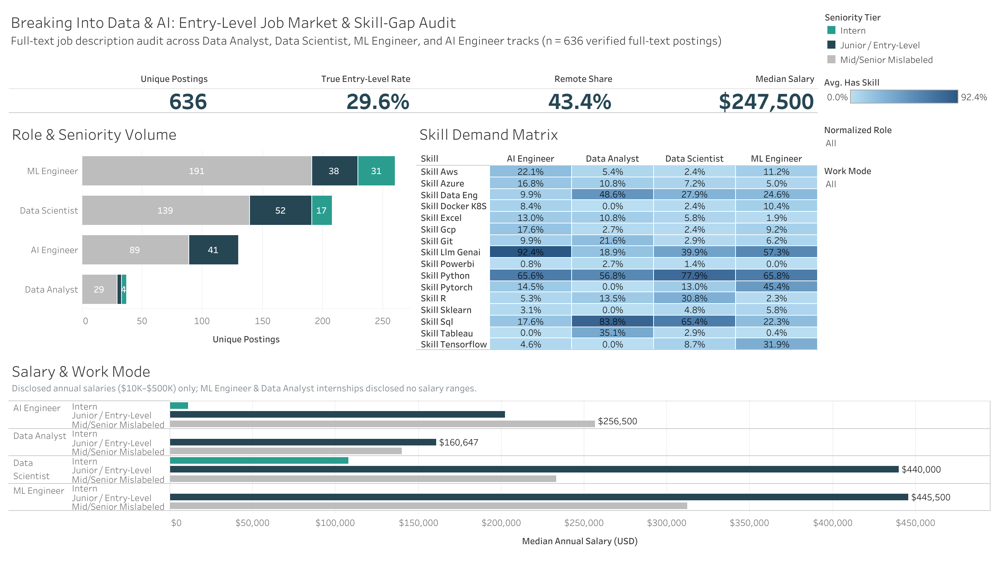

# Entry-Level Data & AI Job Market Audit

An end-to-end data pipeline and market audit analyzing **636 deduplicated, full-text job postings** (≥ 1,000 description characters) across **Data Analyst**, **Data Scientist**, **ML Engineer**, and **AI Engineer** roles, to identify the highest-ROI career entry points and the real technical stack requirements.

🔗 **[Interactive Tableau Dashboard](https://public.tableau.com/app/profile/pablo.chavez3688/viz/BreakingIntoDataAIEntry-LevelJobMarketAudit/Entry-LevelDataAIAudit)** · 📄 **[Full Case Study Report](https://pchaher03.github.io/data-science-jobs-analysis/case_study_report.html)** · 🖥️ **[Presentation](https://pchaher03.github.io/data-science-jobs-analysis/executive_presentation.html)** · 📋 **[Project Specs](docs/project_vision.md)**



## Key Findings

* **The "Entry-Level" Filtering Gap:** **70.4%** (448 of 636) of full-text postings on public career boards had no senior title tag but still required **4+ years of experience** or senior responsibilities. That leaves **188 verified Intern and Junior / Entry-Level roles**.
* **Lowest-Barrier Engineering Track:** **AI Engineer** (n = 42) has the lowest formal credential barrier among the technical tracks: **16.7%** mention a Master's or PhD, and **76.2%** specify no degree requirement. These roles emphasize applied **Python (69.0%)** and **LLM / GenAI (95.2%)** delivery over graduate research credentials.
* **Core vs. Differentiator Skills:** **Python** is the most consistent baseline (50.0%–84.1% across tracks). **SQL** varies widely (14.3%–87.5%) and mainly defines Data Analyst roles. **LLM / GenAI** dominates AI Engineer (**95.2%**) and ML Engineer (**56.5%**), **PyTorch (63.8%)** separates ML Engineering, and **SQL (87.5%) + BI Tools (25.0%)** anchor Data Analyst roles.

### Verified Intern & Junior / Entry-Level Benchmark (n = 188)

| Normalized Role | Verified Openings | SQL | Python | BI Tools | Cloud / MLOps | Junior Median Salary* |
| :--- | :---: | :---: | :---: | :---: | :---: | :---: |
| **Data Scientist** | 69 (17 Intern, 52 Jr) | 44.9% | 62.3% | 7.2% | 27.5% | USD 440,000 |
| **ML Engineer** | 69 (31 Intern, 38 Jr) | 17.4% | 84.1% | 1.4% | 34.8% | USD 445,500 |
| **AI Engineer** | 42 (1 Intern, 41 Jr) | 14.3% | 69.0% | 14.3% | 14.3% | USD 202,500 |
| **Data Analyst** | 8 (4 Intern, 4 Jr) | 87.5% | 50.0% | 25.0% | 25.0% | USD 160,647 |

*\*Only 13.3% (25 of 188) of verified entry-level postings disclosed compensation. Medians reflect coastal tech-hub pay-transparency filings and should be read directionally.*

## Architecture & Tech Stack

* **Ingestion:** Multi-source collection via the official **Adzuna Jobs REST API** and public ATS JSON feeds (**Greenhouse, Lever, Ashby, The Muse**) in **R** (`httr2`, `DBI`, `RPostgres`).
* **Storage & Transformation:** **PostgreSQL 16** and **SQL**: a ≥ 1,000-character full-text quality gate, window-function deduplication, and POSIX regex extraction across 16 skills plus experience and degree tiers.
* **Reproducibility & Reporting:** **Docker Compose**, **Rocker** (`rocker/tidyverse`), and **Quarto**.
* **Visualization:** **Tableau Public**.

## Quickstart

```bash
cp .env.example .env          # Add ADZUNA_APP_ID and ADZUNA_APP_KEY
docker compose up --build -d  # Launch PostgreSQL and Rocker R/Quarto containers
```

See [docs/project_vision.md](docs/project_vision.md) for full functional requirements, methodology, and data governance.